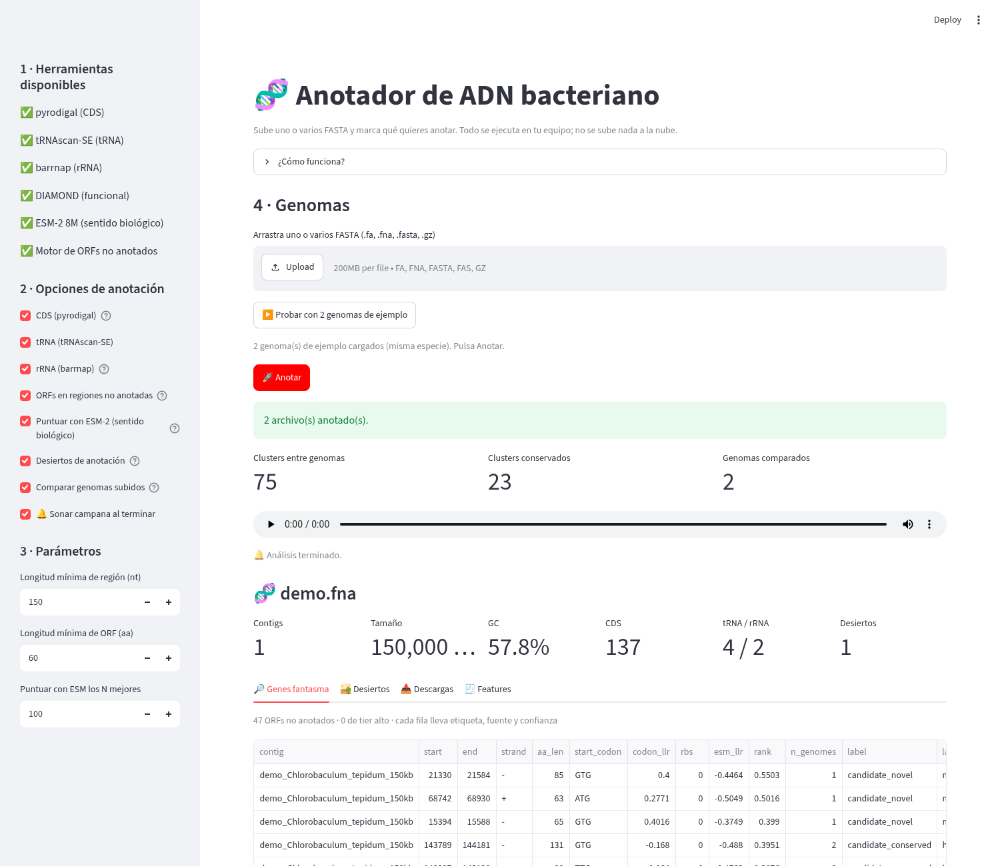

# 🧬 Anotador de ADN bacteriano

🌐 **Español** · [English](README.en.md) · [中文](README.zh.md)

[](https://github.com/Krim10000/Bacterial-DNA-Annotator/actions/workflows/ci.yml)
[](https://github.com/Krim10000/Bacterial-DNA-Annotator/releases)
[](CHANGELOG.md)
[](LICENSE)
[](pyproject.toml)
[](#-idiomas)

Anota genomas bacterianos **desde cero**, encuentra genes que nadie había
anotado, reconstruye rutas metabólicas, busca las brechas que le impiden vivir
y propone operones y promotores. Todo corre en tu computador y se maneja desde
una interfaz web.

Pensado para que lo use un estudiante de secundaria sin miedo y un
investigador con datos propios: cada resultado declara **de dónde sale**, con
qué **confianza** y qué **no** prueba.

> **No necesitas GPU.** La anotación, las brechas, los operones y el navegador
> funcionan en CPU. La GPU solo se usa para ESMFold local y para entrenar el
> modelo de ADN, que son opcionales. Ver [`docs/GPU_STATUS.md`](docs/GPU_STATUS.md).



## ⚡ Instalación en Ubuntu (3 pasos)

```bash
git clone https://github.com/Krim10000/Bacterial-DNA-Annotator.git DNA_TOKEN_BAC
cd DNA_TOKEN_BAC
bash install.sh --with-data
```

`install.sh` crea un entorno virtual, instala las dependencias, descarga
Swiss-Prot y Rhea (~120 MB) y añade **«Anotador de ADN» al menú de
aplicaciones**. Después:

- abre **Anotador de ADN** desde Aplicaciones, o
- ejecuta `./lanzar.sh` (doble clic también funciona).

Opciones del instalador:

| comando | qué hace |
|---|---|
| `bash install.sh` | entorno + lanzador (sin descargar datos) |
| `bash install.sh --with-data` | + Swiss-Prot y Rhea |
| `bash install.sh --with-tools` | + tRNAscan-SE, barrnap, HMMER, DIAMOND (pide sudo) |
| `bash install.sh --full` | + todas las dependencias del pipeline |
| `bash install.sh --dry-run` | muestra lo que haría, sin tocar nada |
| `bash install.sh --uninstall` | quita el lanzador del menú |

En GNOME, la primera vez que ejecutes un `.desktop` puede que tengas que
marcarlo como de confianza (clic derecho → *Permitir lanzar*). El instalador ya
lo deja en `~/.local/share/applications`.

### Alternativa manual

```bash
python3 -m venv .venv
.venv/bin/pip install -r requirements-annotator.txt
.venv/bin/python -m streamlit run webapp/app.py
```

Abre <http://localhost:8501>.

### Demo incluida (sin descargar datos)

En **🧬 Navegador de genoma** elige el genoma **`demo`**, o pulsa
**🧬 Explorar la demo del navegador** en la pantalla de inicio. Son 150 kb de
*Chlorobaculum tepidum* anotados desde cero: genes predichos con pyrodigal y
operones agrupados por proximidad y hebra. Sirve para probar el navegador y las
fichas al hacer clic; **no** es evidencia experimental ni se usa en las
métricas del proyecto. El resto de modos necesita los datos del proyecto.

## ⏱️ Requisitos y tiempos

| | mínimo | recomendado |
|---|---|---|
| Sistema | Ubuntu 22.04/24.04, macOS o WSL | Ubuntu 24.04 |
| Python | 3.10 | 3.11 o 3.12 |
| RAM | 8 GB | 16 GB |
| Disco | 10 GB | 25 GB con todas las bases |
| CPU | 4 núcleos | 8 núcleos |
| GPU | **no hace falta** | opcional para ESMFold |
| Red | solo para la primera descarga | — |

Tiempos aproximados en un portátil de 8 núcleos sin GPU:

| paso | tiempo |
|---|---|
| Anotar un genoma de ~5 Mb | 1–3 min |
| Buscar ORFs no anotados | ~5 s por genoma |
| Red metabólica y brechas | ~2 min por genoma |
| Operones por reglas | ~8 s por genoma |
| Horquillas de terminación | 1–10 min por genoma |
| Comparar dos genomas | 1–5 min |
| ESMFold (API Neurosnap) | 1–2 min por proteína (~0,04 créditos) |
| Entrenar el modelo de ADN | horas en GPU (no hace falta para anotar) |

La app muestra esta misma tabla en **⏱️ ¿Qué necesito y cuánto tarda?**, junto
con un glosario para quien nunca oyó hablar de DIAMOND, HMMER o un operón.

## 🌐 Idiomas

La interfaz está en **español, inglés y chino simplificado**. El selector está
al principio de la barra lateral y se recuerda en el equipo. También puedes
enlazar directamente:

```
http://localhost:8501/?lang=en
http://localhost:8501/?lang=zh
```

Los **datos no se traducen**: los productos génicos, las rutas y las etiquetas
del pipeline se muestran tal como los produce la fuente. Para añadir un idioma,
copia `webapp/locales/en.json`, traduce los valores y añade el código en
`webapp/i18n.py`; `tests/test_i18n.py` comprueba que no falte ninguna clave.

## 🖥️ La interfaz

Seis modos en la barra lateral:

| modo | para qué |
|---|---|
| 🧬 **Anotar FASTA** | subes uno o varios genomas y descargas GFF3, proteínas, candidatos y desiertos |
| 🧪 **Rutas metabólicas** | exploras el análisis ya calculado de 400 genomas (brechas, cierres, operones, movilidad, membrana, taxonomía…) |
| 🧬 **Navegador de genoma** | ves una ventana del genoma con pistas y **haces clic en un gen** para leer su ficha |
| 📥 **Reportes y descargas** | reúne los TSV/JSON/Markdown disponibles, con tamaño, fuente y licencia, y arma un ZIP de resultados |
| 🧩 **Módulos** | cada módulo declara sus opciones, estado, tiempo y autoprueba; la interfaz se construye sola |
| 🙏 **Créditos y herramientas** | quién hizo cada pieza, con enlace, cita y licencia |

### El ADN es clicable

En el navegador, cada gen, operón, promotor, horquilla y sospecha metabólica
tiene una ficha: al pulsarlo se muestra producto, coordenadas, hebra, EC,
confianza, cajas −10/−35, ΔG, genes vecinos y la interpretación de esa pista.
El detalle no sustituye la tabla: la complementa.

También puedes buscar por coordenada (`1000000-1050000`), gen (`thrA`),
producto (`proteasa`), EC o reacción (`RHEA:12345`), y compartir un enlace a
una región con `?genoma=...&contig=...&pos=...`.

### Descargas para investigación

Cada tabla tiene su botón de descarga en TSV/CSV; los informes se descargan en
Markdown y los resultados estructurados en JSON. Los GFF3 se pueden abrir en
Artemis, IGV o NCBI. En **Brechas** están las descargas de revisión, evidencia
y candidatos de mapeo; en **Completitud**, el informe de rutas esenciales.

Los archivos llevan columnas de **evidencia, confianza y estado**. No hay
resultados «confirmados» sin EC, contexto o experimento.

## 🔬 Qué calcula

```
FASTA
  ├─ CDS (pyrodigal), tRNA (tRNAscan-SE), rRNA (barrnap)
  ├─ ORFs no anotados (motor ghost) + ESM-2 opcional
  ├─ Desiertos de anotación (≥3 kb sin señales)
  ├─ Red metabólica (DIAMOND + Swiss-Prot + Rhea)
  │    └─ brechas, cierres por dominio/homología, transporte
  ├─ Operones: reglas deterministas, promotores, horquillas
  ├─ Móviles/defensa, membrana, taxonomía, cadenas, alostería
  └─ Informe + GFF3 + TSV/JSON descargables
```

Cada etapa es idempotente y se puede correr por separado:

```bash
bash run_pipeline.sh doctor        # comprobar entorno
bash run_pipeline.sh components    # verdad de referencia y componentes
bash run_pipeline.sh rules         # operones por reglas (8 s)
bash run_pipeline.sh hairpins      # horquillas de terminación
bash run_pipeline.sh closure       # cierres de brecha
```

Sin argumentos **no** se ejecuta todo: hay que pedir la etapa.

## 🧩 Módulos

La vista **Módulos** descubre las carpetas de `modules/` y construye sola el
selector, las opciones, el estado, el tiempo estimado y el botón de autoprueba.
Añadir un módulo es dejar `modules/<id>/module.py` con su `MODULE`; no hay que
editar `app.py`. Cada módulo se puede probar sin GUI:

```bash
python -m modules --list
python -m modules --describe annotation
python -m modules --selftest annotation
```

Contrato completo en [`docs/MODULES.md`](docs/MODULES.md).

## 📦 Datos: qué incluye el repositorio y qué no

Este repositorio **no redistribuye** RegulonDB, KEGG, DoriC, STRING, DBTBS ni
BATTER: tienen licencias académicas o de suscripción. Se descargan en tu equipo
con los scripts indicados y quedan fuera de git. Las bases que sí se pueden
redistribuir (Rfam, Pfam, UniProt, PDB, AlphaFold DB, Rhea, ChEBI) tampoco se
versionan por tamaño: se descargan una vez.

- Régimen completo: [`DATA_NOTICE.md`](DATA_NOTICE.md).
- Cómo regenerar cada base: [`docs/INSTALL.md`](docs/INSTALL.md) y
  [`docs/EXTERNAL_SOURCES.md`](docs/EXTERNAL_SOURCES.md).
- Datos de demostración: `webapp/samples/demo.fna` y `demo1b.fna`.

La app funciona sin datos del proyecto para **anotar un FASTA**. Los modos que
exploran los 400 genomas necesitan que esos datos estén generados o
descargados; si faltan, la app lo dice y muestra el comando.

## 🖥️ GPU

| etapa | GPU | estado en v1.0 |
|---|---|---|
| Anotación, brechas, operones, navegador | no | ✅ incluido |
| Filtros estructurales (Foldseek, P2Rank, AlphaFill) | no | ✅ incluido |
| ESMFold por Neurosnap | no (remoto) | ☁️ opcional, consume crédito |
| ESMFold local | ≥16 GB VRAM | ⛔ no incluido |
| Entrenamiento/evaluación del modelo de ADN | A10G | ⚠️ experimental, no evaluado |
| MM/GBSA, ABFE, dinámica molecular | GPU | ⛔ fuera de v1.0 |

Detalle, evidencia y costes en [`docs/GPU_STATUS.md`](docs/GPU_STATUS.md).

## 🙏 Créditos

**Autor:** Camilo Rojas Bravo — Ingeniero en Biotecnología, titulado de la Universidad de Santiago de Chile (USACH); sin afiliación institucional actual — Camilo.Rojas@usach.cl.

**Asistencia de desarrollo:** DeepSeek Harness (DSH) con el modelo DeepSeek,
**noviembre de 2026**, en revisión de código, traducción de la interfaz,
documentación, pruebas de GUI y empaquetado. Las decisiones científicas, los
datos y la validación son responsabilidad del autor.

Este proyecto se apoya en programas y bases de datos de terceros: pyrodigal,
DIAMOND, HMMER, Infernal, tRNAscan-SE, barrnap, ViennaRNA, Streamlit, Rhea,
RegulonDB, UniProt, Pfam, Rfam, Foldseek, P2Rank, AlphaFill, M-CSA, ESM-2 y
muchos más. Cada uno tiene su autoría, su cita y su licencia en la página
**Créditos** y en [`THIRD_PARTY_LICENSES.md`](THIRD_PARTY_LICENSES.md).

## 📄 Citación y licencia

- Cita con [`CITATION.cff`](CITATION.cff) o con
  [`AUTHORS.md`](AUTHORS.md#cómo-citar).
- Código original: **MIT** ([`LICENSE`](LICENSE)).
- Dependencias: conservan su licencia. **pyrodigal, orcapy, DIAMOND,
  tRNAscan-SE y barrnap son GPL-3.0**; cualquier distribución que las empaquete
  (imagen Docker, `.deb`, servicio) debe cumplir la GPL-3.0.
- Datos: [`DATA_NOTICE.md`](DATA_NOTICE.md).

## 📁 Estructura

```
modules/           módulos autodescubiertos (opciones, estado, test, run)
webapp/            interfaz Streamlit, i18n, navegador, créditos
  locales/         es.json, en.json, zh.json
  components/      componente del genoma clicable (sin build)
  samples/         dos FASTA de demostración
scripts/           340 scripts por etapa (ver scripts/README.md)
docs/              instalación, pipeline, GPU, decisiones, fuentes
tools/             utilidades de desarrollo (extraer textos, índice)
tests/             pruebas de i18n, imports y GUI
install.sh         instalador Ubuntu + lanzador
lanzar.sh          arranque con doble clic
run_pipeline.sh    orquestador por etapas
```

## ⚠️ Límites conocidos

- La predicción de operones por secuencia se queda en **F1 ≈ 0.78–0.81**; dos
  métodos independientes convergen ahí.
- Las **horquillas son una pista, no una frontera**: 70 de los 375 terminadores
  curados de K-12 están dentro de su operón y ~10 % son dependientes de Rho.
- El lado **3′** de los operones está poco cubierto: los TTS cubren el 16 % de
  las fronteras frente al 61 % de los TSS.
- Los componentes curados existen solo para *E. coli* K-12; para el resto se
  predicen desde la secuencia.
- El **modelo de ADN no está evaluado** en esta versión (sin GPU). No se usa
  para anotar.
- Una brecha **no prueba** que falte una enzima: puede ser un gen no anotado,
  transporte, ruta alternativa o un falso positivo. La app lo dice en cada
  ficha.

## 🇬🇧 English summary

Bacterial genome annotator with a Streamlit GUI (Spanish, English, Simplified
Chinese), a clickable genome browser, metabolic gap analysis and downloadable
GFF3/TSV/JSON reports. It runs on CPU; no GPU is required for annotation. It
does **not** redistribute RegulonDB, KEGG, DoriC, STRING, DBTBS or BATTER data:
they are downloaded locally under their own terms. Original code is MIT;
third-party components keep their licenses (several are GPL-3.0). Author:
Camilo Rojas Bravo (Biotechnology Engineer, graduated from USACH;
currently without an institutional affiliation; Camilo.Rojas@usach.cl).
Development assistance:
DeepSeek Harness with DeepSeek, November 2026.

## ⭐ ¿Te sirvió?

Si este proyecto te ahorró tiempo, **dale una estrella en GitHub**:
[github.com/Krim10000/Bacterial-DNA-Annotator](https://github.com/Krim10000/Bacterial-DNA-Annotator).
No cuesta nada y ayuda a que otras personas lo encuentren.

---

Hecho en Chile, con datos y preguntas de biología reales. Si encuentras un
error, abre un *issue* con el genoma, la etapa y el comando exacto.
