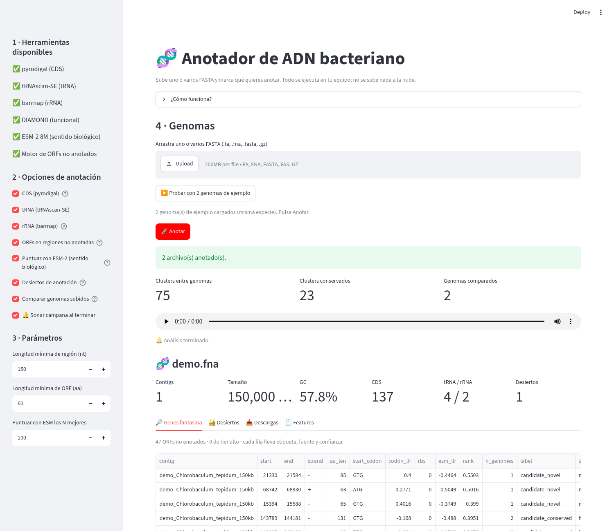

# 🧬 细菌 DNA 注释器

🌐 [Español](README.es.md) · [English](README.md) · **中文**

[](https://github.com/Krim10000/Bacterial-DNA-Annotator/actions/workflows/ci.yml)
[](https://github.com/Krim10000/Bacterial-DNA-Annotator/releases)
[](https://doi.org/10.5281/zenodo.24469732)
[](CHANGELOG.md)
[](LICENSE)
[](pyproject.toml)
[](#-语言)

**从头**注释细菌基因组，发现此前无人注释过的基因，重建代谢通路，查找让生物体无法存活的缺口，并提出操纵子和启动子。全部计算都在你自己的电脑上完成，通过网页界面操作。

设计上，一个中学生可以放心上手，带着自己数据的研究人员也同样适用：每个结果都会说明它**来自哪里**、具有怎样的**置信度**，以及它**不能**证明什么。

> **你不需要 GPU。** 注释、缺口、操纵子和浏览器都能在 CPU 上运行。GPU 只用于本地 ESMFold 和训练 DNA 模型，这两项都是可选的。参见 [`docs/GPU_STATUS.en.md`](docs/GPU_STATUS.en.md)。

## 🧭 范围一览

目标是从 DNA 序列出发，了解物种、蛋白质、代谢通路、操纵子以及调控环路，
并且始终标注证据和局限。

| 层次 | 状态 |
|---|---|
| 物种 / 分类学 | ✅ 已实现 |
| 基因、蛋白质和未注释 ORF | ✅ 已实现 |
| 功能 / EC / UniProt | ✅ 对同源蛋白已实现 |
| 代谢通路与缺口 | ✅ 已实现 |
| 操纵子与启动子 | ✅ 已实现 |
| 调控环路 | 🟡 部分：已有候选抑制蛋白和操作子；缺少效应物的方向/幅度 |
| 未知蛋白缩减（400 个基因组） | 🟡 部分：已有廉价过滤和结构门控；结构集尚未完成 |
| DNA 语言模型 | ⛔ 实验性，未评估 |

完整状态、GPU 限制和 Kaggle 策略：
[`docs/ROADMAP.md`](docs/ROADMAP.md)。



## ⚡ 在 Ubuntu 上安装（3 步）

```bash
git clone https://github.com/Krim10000/Bacterial-DNA-Annotator.git DNA_TOKEN_BAC
cd DNA_TOKEN_BAC
bash install.sh --with-data
```

`install.sh` 会创建虚拟环境、安装依赖、下载 Swiss-Prot 和 Rhea（约 120 MB），并把**«Anotador de ADN»（DNA 注释器）添加进应用程序菜单**。之后：

- 从“应用程序”中打开 **Anotador de ADN**，或者
- 运行 `./lanzar.sh`（双击同样可用）。

安装器选项：

| 命令 | 作用 |
|---|---|
| `bash install.sh` | 环境 + 启动器（不下载数据） |
| `bash install.sh --with-data` | + Swiss-Prot 和 Rhea |
| `bash install.sh --with-tools` | + tRNAscan-SE、barrnap、HMMER、DIAMOND（需要 sudo） |
| `bash install.sh --full` | + 流程所需的全部依赖 |
| `bash install.sh --dry-run` | 显示将要执行的操作，不改动任何东西 |
| `bash install.sh --uninstall` | 从菜单中移除启动器 |

在 GNOME 上，第一次运行 `.desktop` 文件时可能需要把它标记为可信（右键 → *允许启动*）。安装器已经把它放在 `~/.local/share/applications`。

### 手动安装

```bash
python3 -m venv .venv
.venv/bin/pip install -r requirements-annotator.txt
.venv/bin/python -m streamlit run webapp/app.py
```

打开 <http://localhost:8501>。

### 内置演示（无需下载数据）

在 **🧬 基因组浏览器** 中选择 **`demo`** 基因组，或在起始界面点击 **🧬 浏览演示基因组**。这是 150 kb 的 *Chlorobaculum tepidum* 从头注释结果：用 pyrodigal 预测基因，并按位置邻近性和链方向分组为操纵子。它的用途是让你试用浏览器以及点击后弹出的卡片；它**不是**实验证据，也不用于项目的指标计算。其他模式需要项目数据。

Windows 或 macOS？请使用 Docker：[`docs/INSTALL_DOCKER.md`](docs/INSTALL_DOCKER.md)。

更新与订阅发布说明：[`docs/UPDATES.md`](docs/UPDATES.md)。

## ⏱️ 环境要求与运行时间

| | 最低 | 推荐 |
|---|---|---|
| 系统 | Ubuntu 22.04/24.04、macOS 或 WSL | Ubuntu 24.04 |
| Python | 3.10 | 3.11 或 3.12 |
| 内存 | 8 GB | 16 GB |
| 磁盘 | 10 GB | 25 GB（含全部数据库） |
| CPU | 4 核 | 8 核 |
| GPU | **不需要** | 可选，用于 ESMFold |
| 网络 | 仅首次下载时需要 | — |

在 8 核、无 GPU 的笔记本上的大致耗时：

| 步骤 | 时间 |
|---|---|
| 注释约 5 Mb 的基因组 | 1–3 分钟 |
| 查找未注释的 ORF | 每个基因组约 5 秒 |
| 代谢网络与缺口 | 每个基因组约 2 分钟 |
| 基于规则的操纵子 | 每个基因组约 8 秒 |
| 终止发夹结构 | 每个基因组 1–10 分钟 |
| 比较两个基因组 | 1–5 分钟 |
| ESMFold（Neurosnap API） | 每个蛋白质 1–2 分钟（约 0.04 积分） |
| 训练 DNA 模型 | GPU 上数小时（注释不需要） |

应用会在 **⏱️ 我需要什么，要多久？** 页面中展示同一张表，并附一份术语表，供从未听说过 DIAMOND、HMMER 或操纵子的人参考。

## 🌐 语言

界面提供**西班牙语、英语和简体中文**。语言选择器位于侧边栏顶部，你的选择会保存在本机。也可以直接通过链接访问：

```
http://localhost:8501/?lang=en
http://localhost:8501/?lang=zh
```

**数据不会被翻译**：基因产物、通路和流程标签都按数据源生成的原始形式显示。要新增一门语言，请复制 `webapp/locales/en.json`，翻译其中的值，并在 `webapp/i18n.py` 中加入对应代码；`tests/test_i18n.py` 会检查是否有缺失的键。

## 🖥️ 界面

侧边栏中有六种模式：

| 模式 | 用途 |
|---|---|
| 🧬 **注释 FASTA** | 上传一个或多个基因组，下载 GFF3、蛋白质、候选基因和注释荒漠 |
| 🧪 **代谢通路** | 浏览已算好的 400 个基因组分析（缺口、闭合、操纵子、可移动性、膜、分类……） |
| 🧬 **基因组浏览器** | 查看基因组的某个窗口及其轨道，并**点击基因**阅读它的卡片 |
| 📥 **报告与下载** | 汇总可用的 TSV/JSON/Markdown 文件，含大小、来源和许可证，并可打包成结果 ZIP |
| 🧩 **模块** | 每个模块声明选项、状态、预计时间和自检；界面自动构建 |
| 🙏 **致谢与工具** | 每个部分的作者是谁，附带链接、引用和许可证 |

### DNA 可点击

在浏览器中，每个基因、操纵子、启动子、发夹结构和代谢疑点都有一张卡片：点击后会显示产物、坐标、链、EC、置信度、−10/−35 框、ΔG、相邻基因以及对该线索的解读。详情并不取代表格，而是对表格的补充。

你还可以按坐标（`1000000-1050000`）、基因（`thrA`）、产物（`protease`）、EC 或反应（`RHEA:12345`）搜索，并用 `?genoma=...&contig=...&pos=...` 分享某个区域的链接。

### 面向研究的下载

每张表都有自己的 TSV/CSV 下载按钮；报告以 Markdown 下载，结构化结果以 JSON 下载。GFF3 文件可以在 Artemis、IGV 或 NCBI 中打开。在 **缺口** 下可以找到用于复核、证据和映射候选的下载项；在 **完整度** 下是必需通路报告。

文件都带有**证据、置信度和状态**列。没有 EC、上下文或实验的结果不会被标为“已确认”。

## 🔬 计算内容

```
FASTA
  ├─ CDS (pyrodigal), tRNA (tRNAscan-SE), rRNA (barrnap)
  ├─ Unannotated ORFs (ghost engine) + optional ESM-2
  ├─ Annotation deserts (≥3 kb without signals)
  ├─ Metabolic network (DIAMOND + Swiss-Prot + Rhea)
  │    └─ gaps, closure by domain/homology, transport
  ├─ Operons: deterministic rules, promoters, hairpins
  ├─ Mobile/defence, membrane, taxonomy, chains, allostery
  └─ Report + GFF3 + downloadable TSV/JSON
```

每个阶段都是幂等的，可以单独运行：

```bash
bash run_pipeline.sh doctor        # check the environment
bash run_pipeline.sh components    # reference truth and components
bash run_pipeline.sh rules         # rule-based operons (8 s)
bash run_pipeline.sh hairpins      # termination hairpins
bash run_pipeline.sh closure       # gap closure
```

不带参数时它**不会**运行全部流程：你需要指定要执行的阶段。

## 🧩 模块

**模块** 视图会发现 `modules/` 下的文件夹，并自行构建选择器、选项、状态、预计时间和自检按钮。添加一个模块只需放入带有 `MODULE` 的 `modules/<id>/module.py`，无需修改 `app.py`。每个模块都可以脱离 GUI 测试：

```bash
python -m modules --list
python -m modules --describe annotation
python -m modules --selftest annotation
```

完整契约见 [`docs/MODULES.en.md`](docs/MODULES.en.md)。

## 📦 数据：仓库包含什么、不包含什么

本仓库**不重新分发** RegulonDB、KEGG、DoriC、STRING、DBTBS 或 BATTER：它们采用学术许可或订阅许可。这些数据会通过所示脚本下载到你的机器上，并留在 git 之外。可以再分发的数据库（Rfam、Pfam、UniProt、PDB、AlphaFold DB、Rhea、ChEBI）同样不纳入版本控制，因为它们体积太大：只需下载一次。

- 完整条款：[`DATA_NOTICE.md`](DATA_NOTICE.md)。
- 如何重新生成各个数据库：[`docs/INSTALL.en.md`](docs/INSTALL.en.md) 和
  [`docs/EXTERNAL_SOURCES.md`](docs/EXTERNAL_SOURCES.md)。
- 演示数据：`webapp/samples/demo.fna` 和 `demo1b.fna`。

即使没有项目数据，应用也能**注释 FASTA**。浏览 400 个基因组的模式需要这些数据已经生成或下载；如果缺失，应用会明确提示，并给出相应命令。

## 🖥️ GPU

| 阶段 | GPU | v1.0 中的状态 |
|---|---|---|
| 注释、缺口、操纵子、浏览器 | 否 | ✅ 已包含 |
| 结构筛选（Foldseek、P2Rank、AlphaFill） | 否 | ✅ 已包含 |
| 通过 Neurosnap 的 ESMFold | 否（远程） | ☁️ 可选，消耗积分 |
| 本地 ESMFold | ≥16 GB 显存 | ⛔ 未包含 |
| DNA 模型训练/评估 | A10G | ⚠️ 实验性，未评估 |
| MM/GBSA、ABFE、分子动力学 | GPU | ⛔ 不属于 v1.0 |

详情、证据和费用见 [`docs/GPU_STATUS.en.md`](docs/GPU_STATUS.en.md)。

## 🙏 致谢

**作者：** Camilo Rojas Bravo — 生物技术工程师，毕业于智利圣地亚哥大学（USACH）；目前无机构隶属 — Camilo.Rojas@usach.cl。

**开发协助：** DeepSeek Harness（DSH）与 DeepSeek 模型，**2026 年 11 月**，参与代码审查、界面翻译、文档编写、GUI 测试和打包。科学决策、数据和验证由作者负责。

本项目建立在第三方程序和数据库之上：pyrodigal、DIAMOND、HMMER、Infernal、tRNAscan-SE、barrnap、ViennaRNA、Streamlit、Rhea、RegulonDB、UniProt、Pfam、Rfam、Foldseek、P2Rank、AlphaFill、M-CSA、ESM-2 以及更多。每一项的作者、引用和许可证都列在**致谢**页面和 [`THIRD_PARTY_LICENSES.md`](THIRD_PARTY_LICENSES.md) 中。

## 📄 引用与许可

- 引用请使用 [`CITATION.cff`](CITATION.cff) 或
  [`AUTHORS.md`](AUTHORS.md#cómo-citar)。本版本 DOI：
  [10.5281/zenodo.24469732](https://doi.org/10.5281/zenodo.24469732)。
- 原创代码：**MIT**（[`LICENSE`](LICENSE)）。
- 依赖项：各自保留其许可证。**pyrodigal、orcapy、DIAMOND、
  tRNAscan-SE 和 barrnap 为 GPL-3.0**；任何捆绑它们的发行方式
  （Docker 镜像、`.deb`、服务）都必须遵守 GPL-3.0。
- 数据：[`DATA_NOTICE.md`](DATA_NOTICE.md)。

## 📁 目录结构

```
modules/           self-discovered modules (options, status, test, run)
webapp/            Streamlit interface, i18n, browser, credits
  locales/         es.json, en.json, zh.json
  components/      clickable genome component (no build)
  samples/         two demo FASTA files
scripts/           340 scripts by stage (see scripts/README.md)
docs/              installation, pipeline, GPU, decisions, sources
tools/             development utilities (extract texts, index)
tests/             i18n, import and GUI tests
install.sh         Ubuntu installer + launcher
lanzar.sh          double-click startup
run_pipeline.sh    stage orchestrator
```

## ⚠️ 已知局限

- 基于序列的操纵子预测上限在 **F1 ≈ 0.78–0.81**；两种独立方法都在此收敛。
- **发夹结构是线索，不是边界**：375 个经人工审编的 K-12 终止子中有 70 个位于其操纵子内部，约 10% 依赖 Rho。
- 操纵子的 **3′** 侧覆盖较差：TTS 覆盖 16% 的边界，而 TSS 为 61%。
- 经人工审编的组件只存在于 *E. coli* K-12；其余情况均从序列预测。
- 本版本中 **DNA 模型未经过评估**（没有 GPU）。它不用于注释。
- 缺口**不能证明**某个酶缺失：它可能是一个未注释的基因、转运、替代路径或假阳性。应用会在每张卡片上说明这一点。

## 🇪🇸 西班牙语摘要

基于 Streamlit 的细菌基因组注释器（西班牙语、英语和简体中文），可点击的基因组浏览器，代谢缺口分析，以及 GFF3/TSV/JSON 下载。它在 CPU 上运行；注释不需要 GPU。它**不**重新分发 RegulonDB、KEGG、DoriC、STRING、DBTBS 或 BATTER 的数据：这些数据按其自身条款在本地下载。原创代码为 MIT；第三方工具保留各自的许可证（其中多项为 GPL-3.0）。作者：Camilo Rojas Bravo（生物技术工程师，毕业于 USACH；目前无机构隶属；Camilo.Rojas@usach.cl）。开发协助：DeepSeek Harness 与 DeepSeek，2026 年 11 月。

## 🔭 路线图

- **蛋白质查询**：蛋白质 FASTA → 同源物、结构域和功能。
- **未知蛋白缩减**：完成 400 个基因组的无 GPU 过滤和宽泛分类。
- **GPU/Kaggle**：在 Kaggle 上做首轮 ESMFold/共折叠；可选，注释基因组从不依赖它。
- **打包**：macOS 安装器、WSL2 指南和 PyPI。

详情与诚实边界：[`docs/ROADMAP.md`](docs/ROADMAP.md)。

## ⭐ 对你有帮助吗？

如果这个项目为你节省了时间，**请在 GitHub 上给它一颗星**：
[github.com/Krim10000/Bacterial-DNA-Annotator](https://github.com/Krim10000/Bacterial-DNA-Annotator)。
这不花你任何东西，还能帮助更多人发现它。

---

在智利制作，使用真实的数据和真实的生物学问题。如果发现错误，请提交一个 *issue*，附上基因组、阶段和确切的命令。
