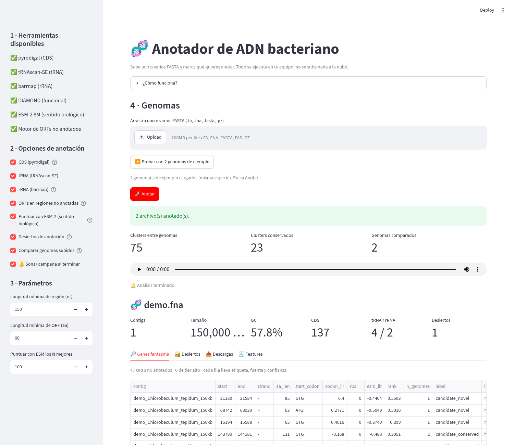
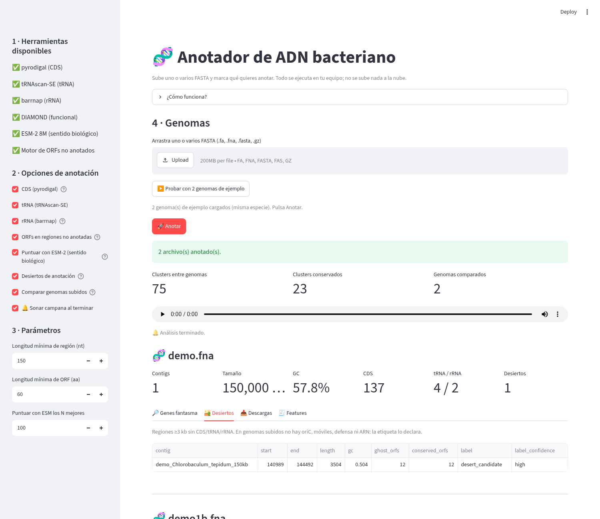
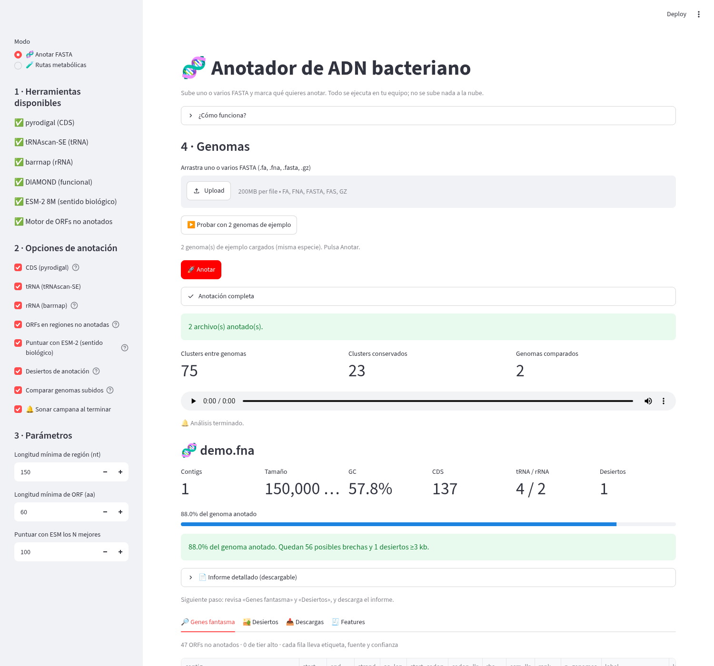
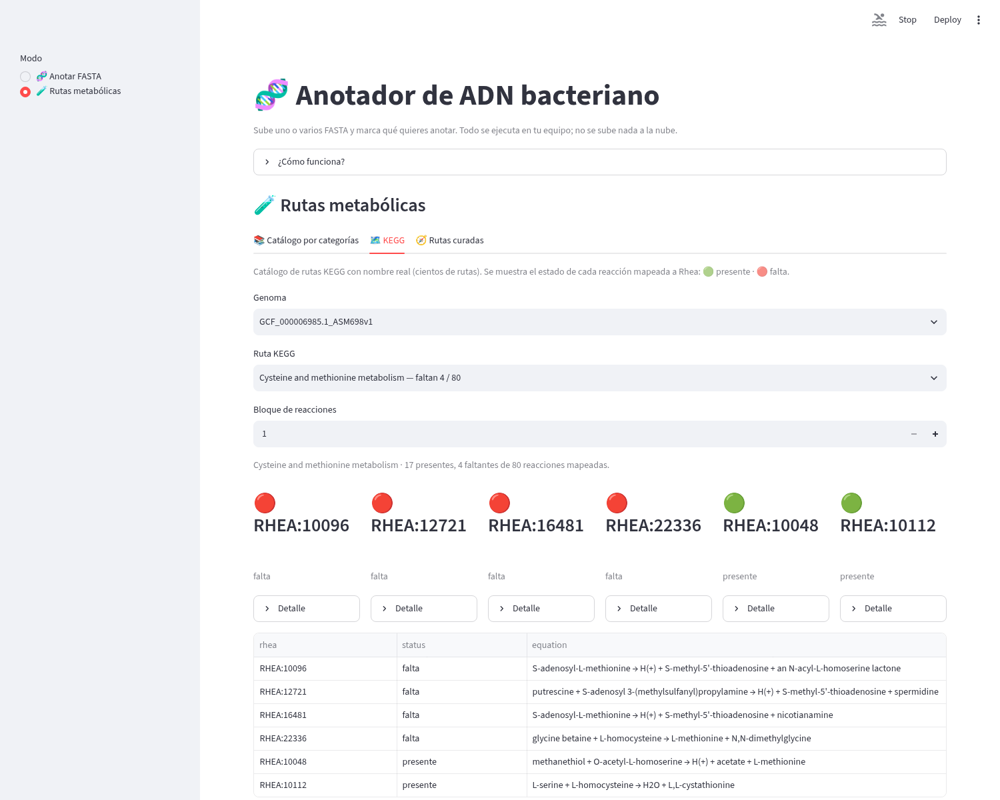
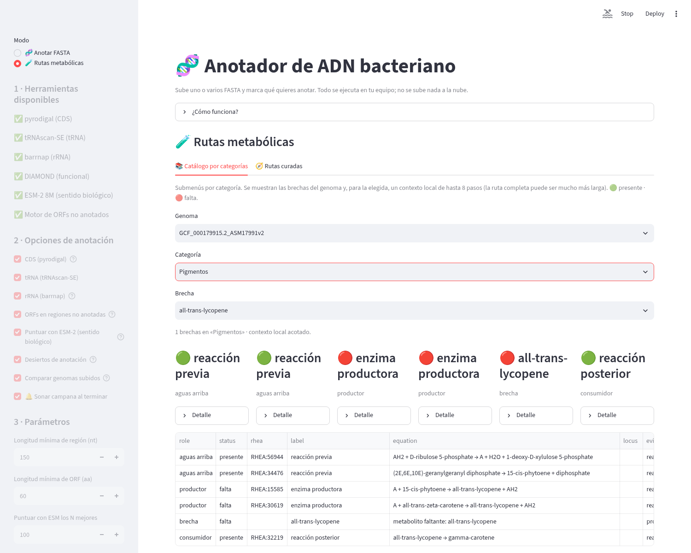
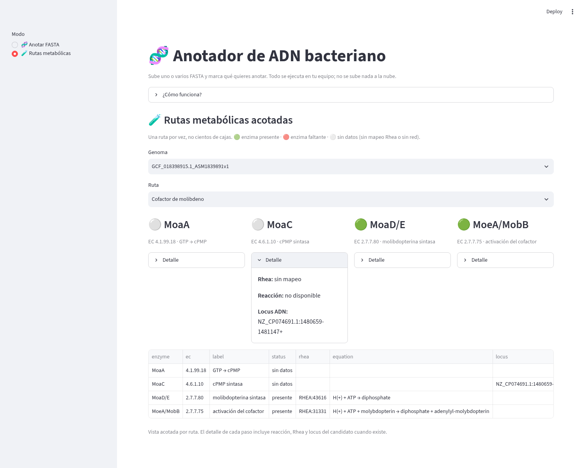

# Anotador de ADN bacteriano — interfaz web

Sube uno o varios FASTA, marca las anotaciones y descarga los resultados.
Todo corre **en tu equipo**: no se sube nada a la nube.

La interfaz está en **español, inglés y chino simplificado** (`?lang=en`), y
tiene cinco modos: Anotar FASTA, Rutas metabólicas, Navegador de genoma,
Reportes y descargas, y Créditos. En el navegador, los genes y pistas del ADN
son clicables y abren una ficha con producto, coordenadas, EC y confianza.





## Primera instalación: recursos

La app necesita Swiss-Prot y Rhea (y opcionalmente Pfam). Se descargan una vez:

```bash
python -m webapp.setup_data --data-root data            # Swiss-Prot + Rhea (~120 MB)
python -m webapp.setup_data --data-root data --pfam     # + Pfam (~600 MB)
python -m webapp.fetch_kegg --data-root data           # catálogo KEGG (~194 rutas)
```

Si faltan, la propia app muestra el comando y un botón de descarga en el modo
**Rutas metabólicas**.

## Inicio rápido

```bash
git clone <tu-repo>
cd dna_poc
python -m venv .venv && . .venv/bin/activate
pip install -r webapp/requirements.txt

# opcional: herramientas externas
sudo apt install trnascan-se infernal hmmer diamond-aligner

streamlit run webapp/app.py
```

Abre `http://localhost:8501`.

## Qué se puede anotar

| casilla | herramienta | dependencia |
|---|---|---|
| CDS | pyrodigal | `pip install pyrodigal` |
| tRNA | tRNAscan-SE | binario `tRNAscan-SE` |
| rRNA | barrnap | binario `barrnap` |
| ORFs no anotados | motor `ghost` | Python puro |
| Sentido biológico | ESM-2 8M (CPU) | `pip install -r webapp/requirements-esm.txt` |
| Desiertos de anotación | ghost | Python puro |
| Comparar genomas subidos | diamond cluster 95% | `diamond` |

La app detecta qué hay instalado y desactiva lo que falta, con el motivo.

## Flujo de usuario

1. Subes un FASTA (0% anotado).
2. Eliges herramientas y parámetros.
3. Pulsas **Anotar**: el flujo es automático y muestra el estado paso a paso.
4. La ventana de resumen dice: **«y% del genoma anotado. Quedan n posibles
   brechas y k desiertos ≥3 kb»**.
5. Un **informe detallado** (Markdown) se ve en la app y se descarga.
6. Siguiente paso: revisar genes fantasma, desiertos o rutas metabólicas.



## Cómo se muestra la información

- **Resumen por genoma**: contigs, tamaño, GC, CDS, tRNA/rRNA y desiertos.
- **Comparación entre genomas subidos**: clusters y clusters conservados.
- **Genes fantasma**: tabla con `rank`, `n_genomes`, `label` y `label_confidence`.
- **Desiertos**: regiones ≥3 kb sin señales, con label y confianza.
- **Descargas**: GFF3, proteínas, candidatos y desiertos (TSV).

Cada fila lleva `label`, `label_source`, `label_evidence`, `label_confidence`,
`label_interpretation`, `label_pipeline` y `label_date`. Ver `LABELS.md`.

## ¿El usuario decide o el flujo es automático?

El usuario decide **antes** de ejecutar:

1. qué análisis marcar;
2. los parámetros (longitud mínima de región/ORF, cuántos ORFs puntuar con ESM);
3. si compara genomas y si suena la campana.

Después de pulsar **Anotar**, el flujo es **automático**: no hay pasos
interactivos ni confirmaciones intermedias. Si algo falla, se reporta por archivo
y el resto continúa.

## Campana

La casilla **🔔 Sonar campana al terminar** reproduce un tono de dos notas al
finalizar. Usa `st.audio(..., autoplay=True)`; si el navegador bloquea el
autoplay, el reproductor queda visible para pulsarlo.

## Docker

```bash
docker build -f webapp/Dockerfile -t dna-annotator .
docker run -p 8501:8501 dna-annotator
```

## Estructura

```
webapp/
  app.py            # interfaz Streamlit
  annotator.py      # backend: pyrodigal, tRNAscan, barrnap, ghost, desiertos, comparación
  requirements.txt
  requirements-esm.txt
  Dockerfile
  samples/demo.fna      # 150 kb
  samples/demo1b.fna    # 150 kb con 50 kb de solapamiento (demo de conservación)
```

## Límites

- En genomas subidos no hay oriC, móviles, defensa ni ARN: la etiqueta de
  desierto lo declara explícitamente.
- La comparación entre genomas usa `diamond cluster` al 95% (umbral elegido en
  el experimento de deduplicación).
- ESM-2 8M corre en CPU (~0,3 s por péptido). ESMFold no se incluye.

## Especie conocida y red metabólica dinámica

- **GCF de referencia (opcional)**: si el genoma está en el proyecto (400), se
  reutiliza su **red precalculada** sin volver a correr DIAMOND.
- **FASTA limpio**: se anotan las proteínas con **DIAMOND vs Swiss-Prot**, se
  mapean a **Rhea** y se construye la red.
- Las brechas se priorizan por **soporte en los 400 genomas de referencia**:
  cuántos tienen una enzima que produciría el metabolito. Soporte 0 = candidata
  **novel** (p. ej. un pigmento raro).
- La red se construye en la pestaña **🧪 Brechas**, con tabla y descarga.

## Catálogo KEGG

La pestaña **🗺️ KEGG** usa nombres reales de rutas (194 rutas, 5.361 reacciones
mapeadas a Rhea) y muestra cada reacción en verde/rojo, con paginación para
rutas largas.



## Rutas metabólicas: catálogo por categorías

El modo **🧪 Rutas metabólicas** tiene dos pestañas:

1. **📚 Catálogo por categorías** (escala a cientos de rutas): submenús de
   Pigmentos, Cofactores y vitaminas, Carbohidratos, Lípidos, Nucleótidos,
   Aminoácidos, Metabolismo central y Otros. Se elige genoma → categoría →
   brecha, y se muestra un **contexto local de hasta 6 pasos** (aguas arriba,
   productores, brecha, consumidores). Las rutas largas **no** se dibujan
   completas: se acota el contexto para no saturar.
2. **🧭 Rutas curadas**: riboflavina, folato, hemo, cofactor de Mo, MTA,
   ácidos grasos y salvamento de pirimidinas.



En ambas:

- 🟢 enzima presente en el genoma,
- 🔴 enzima faltante (brecha refinada),
- ⚪ sin datos (sin mapeo Rhea o sin red).

Cada paso tiene un desplegable **Detalle** con Rhea, ecuación de la reacción,
locus del candidato en el ADN y la evidencia que lo sustenta (cierre etiquetado,
homología DIAMOND o dominio Pfam). La tabla inferior permite recuperar
toda la información.



## Cierre por estructura

En `🧪 Brechas → 5 · Cierre candidato` se puede elegir ESMFold local o Neurosnap API. La GUI indica explícitamente que usa ESMFold, evalúa la máquina y muestra instrucciones. Ver `docs/NEUROSNAP_API.md`.
